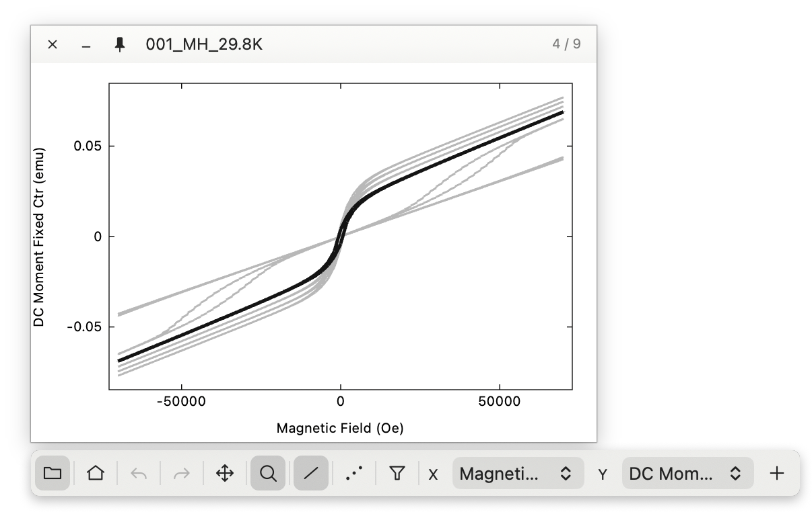
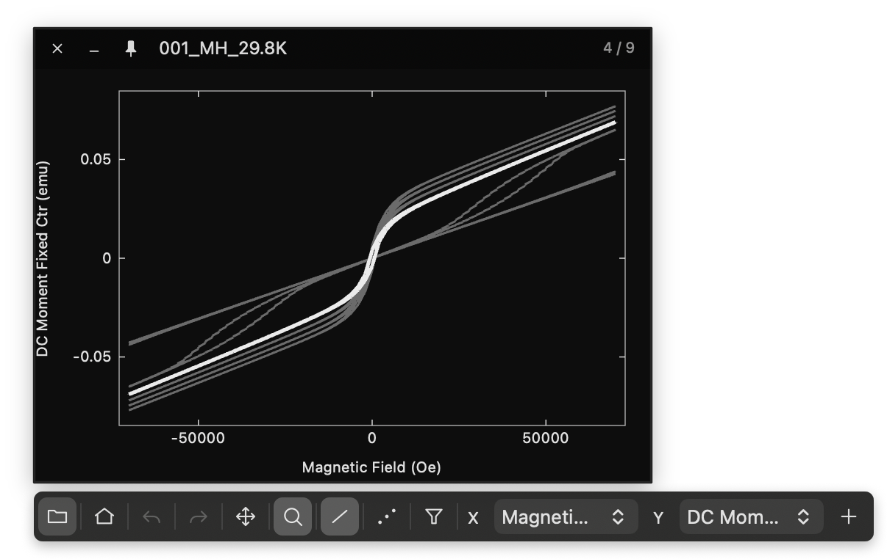

<div align="center">

# Plot

A plotting app for macOS.

[English](README.md)

</div>

<p align="center">
  
</p>
<p align="center">
  
</p>

---

## Setup

Xcode Command Line Toolsが必要。

```sh
./build
```

`/Applications/Plot.app` にインストールして起動される。

## Shortcuts

<details>
<summary>file</summary>

| 操作 | キー | 備考 |
|---|---|---|
| 開く | `⌘O` | |
| 選択中のfileをコピー | `⌘C` | |
| 絶対pathをコピー | `⌥⌘C` | |
| Finderで表示 | `⌥⌘R` | |
| エディタで開く | `⌘E` | 設定で変更可。空欄なら既定のアプリ |
| パネル画像を保存 | `⌘S` | Downloadsへ保存 |

</details>

<details>
<summary>plot</summary>

| 操作 | キー | 備考 |
|---|---|---|
| データの選択 | 矢印キー | |
| 既定のX・Y軸に戻す | `⌘0` | |
| X軸の列を次へ / 前へ | `X` / `⇧X` | |
| Y軸の列を次へ / 前へ | `Y` / `⇧Y` | 最後にクリックしたグラフ。 |
| 外れ値除外 | | |

</details>

<details>
<summary>window</summary>

| 操作 | キー | 備考 |
|---|---|---|
| 新規ウィンドウ | `⌘N` | |
| ウィンドウを閉じる | `⌘W` | |
| 常に手前に表示 | `⌥⌘T` | |
| ウィンドウをタイル配置 | `⌥⌘A` | |
| 設定 | `⌘,` | |

</details>
