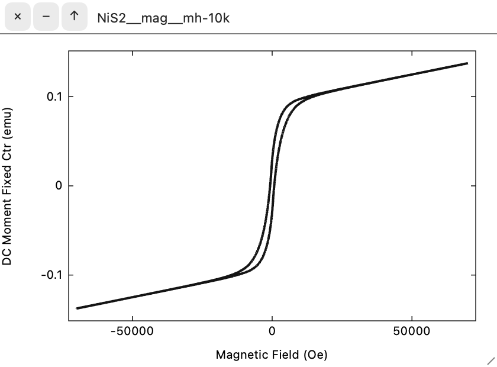
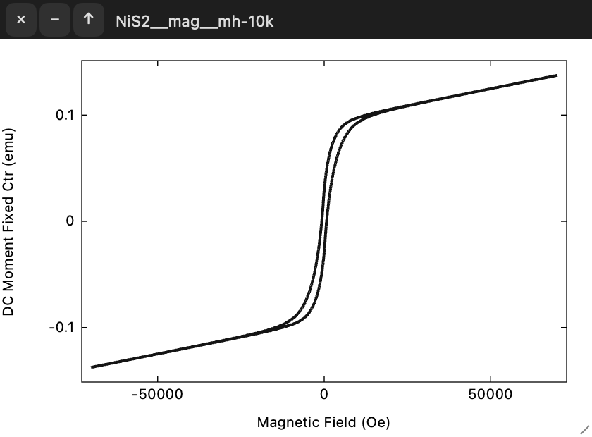

<div align="center">

# Plot

A macOS app for instantly plotting CSV / DAT / RAS / SPEC TXT files.

[日本語](README_jp.md)

</div>

<p align="center">
  
  
</p>

---

## Usage

Open files to plot them. Files opened together share one window when their default X/Y column names match. Without default axes, the first two columns are used.

The selected dataset appears in black; the others stay gray. Use the arrow keys to switch datasets and update the header. The toolbar appears only for the focused window.

## Setup

Requires macOS 13.3+ with Metal support and Xcode Command Line Tools.

```sh
./bin/install-app
```

Installs to `/Applications/Plot.app` and launches it. Run `./bin/install-app` again to update.

Built with Objective-C, AppKit and Metal. No external runtime or libraries. [Rendering and benchmarks](docs/rendering.md).

## Shortcuts

<details>
<summary>All shortcuts</summary>

- Copy selected file — `⌘C`
- Close window — `⌘W`
- Always on top — `⌥⌘T`
- Select dataset — arrow keys
- Open — `⌘O`
- New window — `⌘N`
- Duplicate window — `⇧⌘D`
- Reveal in Finder — `⌥⌘R`
- Open in editor (configurable) — `⌘E`
- Copy absolute path — `⌥⌘C`
- Save panel image (to Downloads) — `⌘S`
- Next / previous X-axis column — `⌘X` / `⇧⌘X`
- Next / previous Y-axis column — `⌘Y` / `⇧⌘Y`
- Open the filter window — `⌥⌘F`
- Open the axes window — `⇧⌥⌘G`
- Exclude outliers — `⇧⌥⌘R`
- Settings — `⌘,`
- Next / previous window — `` ⌘` `` / `` ⇧⌘` ``
- Tile windows — `⌥⌘A`
- Minimize — `⌘M`

</details>
